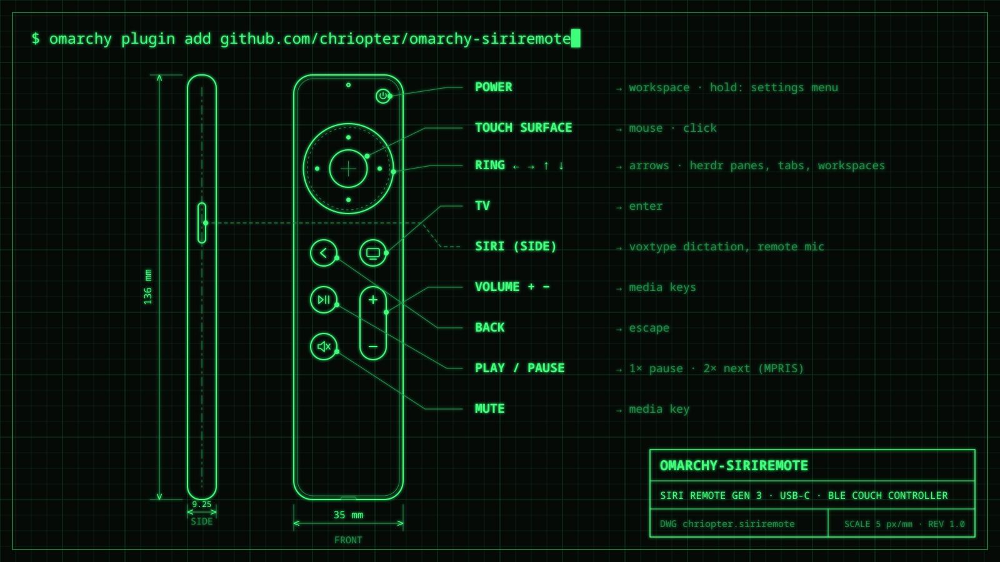

# omarchy-siriremote



Use the Apple Siri Remote (3rd generation, USB-C) as a couch controller for [Omarchy](https://omarchy.org): touch surface as mouse, Siri button for [Voxtype](https://github.com/peteonrails/voxtype) dictation through the remote's own microphone, media keys, and [herdr](https://herdr.dev) / Hyprland navigation. A bar plugin shows connection, battery and dictation, and tunes the touch surface.

## Buttons

| Control | Action |
| --- | --- |
| Touch surface / ring centre | Mouse / left click |
| Ring ← → / ↑ ↓ | Arrow keys; in herdr: the neighbouring pane, at the edge the previous/next tab (← →) or workspace (↑ ↓) |
| TV | Enter |
| Power short / held | Next Omarchy workspace / settings menu in the middle of the screen (display scaling, speaker, voice input; ring ↑ ↓ choose, ← → change, Back closes) |
| Back | Escape |
| Siri hold | Voxtype dictation with the remote's microphone (it exists only while dictating) |
| Play/Pause 1× / 2× | Play/pause / next track and play (via MPRIS, the player that is playing) |
| Volume + − / Mute | Media keys |

## Install

Two parts: the bar plugin, and the driver it shows.

```sh
omarchy plugin add https://github.com/chriopter/omarchy-siriremote --enable
~/.config/omarchy/plugins/chriopter.siriremote/bin/setup
```

The plugin card also offers *Set up driver* when the driver is missing. `bin/setup` installs udev rules, pairs the remote (hold Back + Volume Up) and starts the systemd user service `siri-remote.service`. Optional: `bin/fast-link` asks for a 15–30 ms Bluetooth LE connection interval (system-wide, restarts bluetooth), which makes the touch surface noticeably smoother.

## Remove

```sh
~/.config/omarchy/plugins/chriopter.siriremote/bin/remove   # add --unpair to forget the remote too
omarchy plugin remove chriopter.siriremote
```

`bin/remove` stops the driver and deletes its service, udev rules and settings; it puts the Bluetooth LE connection interval back if `bin/fast-link` changed it.

## Development

```sh
ln -s "$PWD" ~/.config/omarchy/plugins/chriopter.siriremote && omarchy plugin enable chriopter.siriremote
bin/setup   # driver: udev rules, pairing, systemd user service
bin/dev     # run the driver in the foreground instead of the service
bin/update  # pull and restart the driver
```

The shell does not watch files behind a symlinked plugin folder: after changing `plugin/`, run `omarchy restart shell`.

Needs BlueZ, PipeWire (`pactl`), libopus, Python 3.14, and Voxtype, herdr and Hyprland as shipped with Omarchy. Pairing, input, touch, voice and plugin details: [docs/how-it-works.md](docs/how-it-works.md).

MIT licensed, see [LICENSE](LICENSE). Not affiliated with Apple. Siri and Apple TV are trademarks of Apple Inc.
